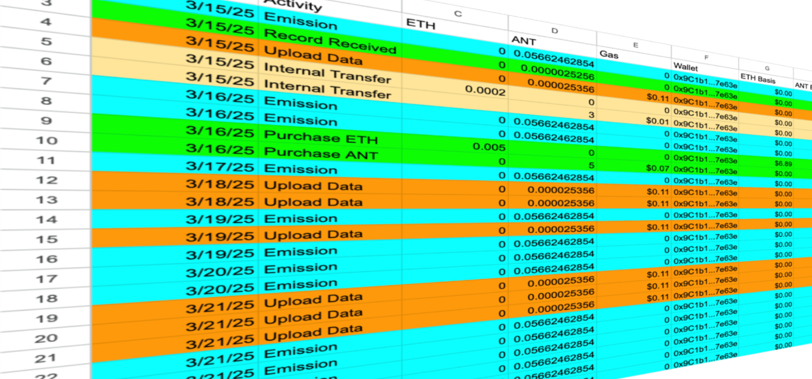
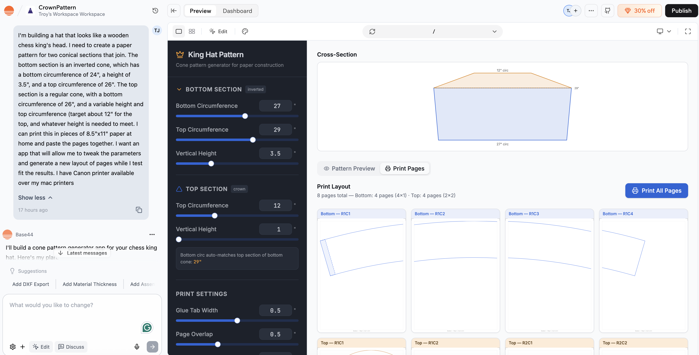
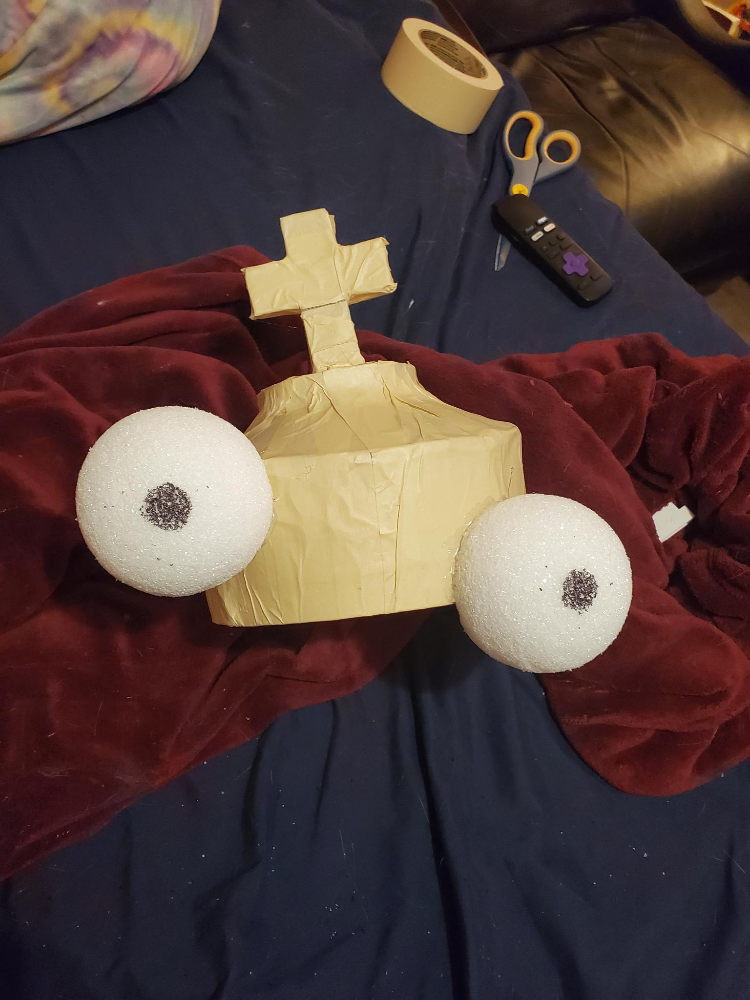

## In the beginning...

It started with annoying suggestions in Visual Studio Code. Sometimes, though, the suggestion was exactly what I was about to type. Pressing Tab could save me ten or more keystrokes. It also raised questions for me about copyright and ownership when AI is involved in producing work.

Then I began encountering AI-generated answers in search results while refreshing my knowledge of math concepts to help my daughter with homework.

My next experiment was visual. I needed an image of a screen showing a spreadsheet for a development competition entry. AI produced an attractive mockup, but the spreadsheet text was wrong. I initially submitted the idea with that image, then took a different approach: I created the exact spreadsheet contents in Google Sheets, printed them to a PDF, and commissioned a local artist to make the flat sheet look like the reference image.

The AI image looked convincing at first glance. It wasn't accurate enough for what I needed.

## Claude: Prototyping a transaction reporter

I used Claude to prototype the [Autonomi Transaction Reporter](https://github.com/ambled/atr). I hit roadblocks and started over several times, but I was getting better at describing the results I wanted.

I managed to put together a rudimentary solution by the competition deadline. By then, however, I had already been disqualified because of an overexcited project supporter.

The experience gave me something more useful than a polished demo: a better sense of how much iteration AI-assisted development can take, even when it gets you started quickly.

## Base44: A pattern-making app for a costume

My daughter asked me to attend an event with her dressed as [Kinger](https://tadc.fandom.com/wiki/Kinger) from [The Amazing Digital Circus](https://en.wikipedia.org/wiki/The_Amazing_Digital_Circus).

I needed a printable template that would join two cone segments to form the foundation of the character's head. I tried several online tools to generate the multi-page, blueprint-sized patterns for the [conical frustums](https://mathworld.wolfram.com/ConicalFrustum.html), without success. I could have drafted them manually, but this seemed like a good excuse to try generating a purpose-built application.

I found [Base44](https://base44.com) while searching for an AI app generator. My 127-word prompt produced an app in about five minutes. The first printout was scaled incorrectly. I requested a change, and the next version looked closer to correct, although it still had rendering defects. It was good enough for this one-time project.

I adjusted the settings for three different paper sizes before cutting the final pattern out of plastic mesh.

After hot-gluing the panels together and forming the joined cones, I built the rest of the crown-like headpiece, including the cross, in mesh. My first plan was to hot-glue paper over the mesh, but I abandoned that almost immediately after nearly burning my fingers.

This costume only needed to survive one event. I was about $16 into a $40 budget that still needed to cover a cape and, optionally, gloves. I found wide masking tape in a color close enough to the character and covered the mesh in vertical strips.

## What these experiments taught me

The tools were useful in different ways. Autocomplete saved small amounts of typing. Image generation helped communicate an idea, but couldn't be trusted with exact spreadsheet content. Claude helped me get a working prototype together through repeated attempts. Base44 gave me a custom tool quickly, even though I still had to correct its output and make practical compromises.

None of those results eliminated the need to check the work. The interesting part, for me, is figuring out where the tools save effort and where they create a different kind of work.
